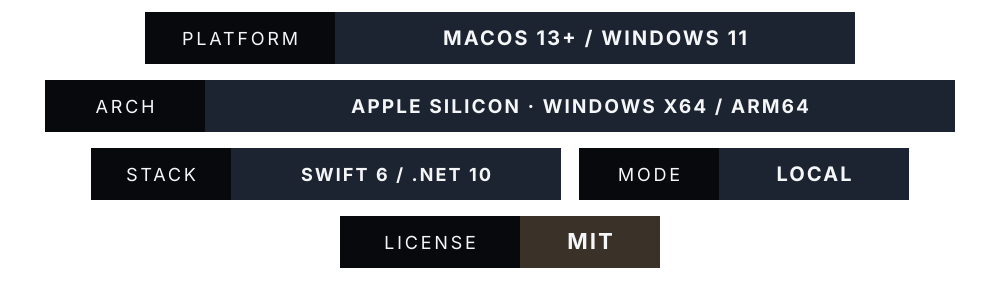

<div align="center">
  
</div>

<p align="center">
  <a href="LICENSE"></a>
</p>

## Download

| Platform | Current build | Download | Requirements |
|---|---|---|---|
| Mac | 0.3.0 test build | [DMG · **246.9 MB**](https://github.com/ishuu9837/Miracle/releases/download/v0.3.0/miracle.dmg) | Apple Silicon, macOS 13+ |
| Windows · Intel / AMD | 0.3.2 preview | [x64 · **275.7 MB**](https://github.com/ishuu9837/Miracle/releases/download/windows-v0.3.2-preview/Miracle-Windows-x64-v0.3.2-compact.7z) | Windows 11 x64 |
| Windows · Snapdragon / ARM VM | 0.3.2 preview | [ARM64 · **240.9 MB**](https://github.com/ishuu9837/Miracle/releases/download/windows-v0.3.2-preview/Miracle-Windows-ARM64-v0.3.2-compact.7z) | Windows 11 ARM64 |

**These are preview builds.** The Mac app is ad-hoc signed and not Apple notarized. Windows builds are unsigned and cannot display a verified publisher. SmartScreen may warn; Smart App Control may block them. Clean-machine reputation checks remain pending. Do not disable security protections to obtain a test pass.

Windows downloads include the .NET runtime and offline engines and expand to approximately **1.3 GB**. Extract the entire `.7z` using Windows 11 24H2+ **Extract All** or current 7-Zip. Keep `Miracle.exe`, `Engines`, and companion files together. If required, install the matching official Microsoft C++ runtime from `Prerequisites`; that installer can request UAC. The app itself runs with standard-user privileges.

[Mac release & setup](https://github.com/ishuu9837/Miracle/releases/tag/v0.3.0) · [Windows release, SHA-256 files & checks](https://github.com/ishuu9837/Miracle/releases/tag/windows-v0.3.2-preview)


Miracle converts files on your computer, without a Miracle account or cloud conversion service. The Mac app lives in the menu bar; Windows lives in the system tray after its main window closes. Quit from the icon's menu to stop the background app and shortcut.

The [documentation](website/documentation.html) covers installation, conversion, troubleshooting and limits. The [Privacy Policy](website/privacy.html) describes local history, permissions, website hosting, Google Fonts and GitHub downloads. Website demos use fictional files and do not process visitor uploads.


### Mac

Select a supported file in Finder, tap **Shift**, and choose an available conversion. The Mac implementation also has separate tool and action wheels; see its [coverage audit](Docs/COVERAGE.md) for implemented scope. Originals are preserved and outputs receive collision-safe names.

### Windows 0.3.2

1. **Buttons:** Add files → choose a colorful output button → **Convert file** → **Show result**.
2. **Drag + Shift:** With Miracle running, drag supported files from a **File Explorer window** and keep holding the mouse button. Tap **Shift** once to open the wheel. Further short taps cycle common formats, then common file tools, in sets of up to six choices. Slide onto an option and release.
3. **Tools and cancellation:** A format drop starts conversion; a tool drop opens its settings first. **Esc** or releasing outside a colored option cancels the drag wheel. The Explorer shortcut can be disabled in the app; a non-drag wheel also has a **Next set** button.

The Windows shortcut does not support desktop selections or arbitrary drag sources in other apps. It observes Shift without recording typed content or swallowing key events. The Mac's six file actions are not implemented in the Windows preview.


| Windows 0.3.2 evidence | Scope |
|---|---|
| x64 | **303/303 feature checks**, **47/47 regressions**, exit zero; Windows ARM64 VM using x64 emulation |
| ARM64 | **47/47 regressions**, exit zero; Windows ARM64 VM. Full feature suite not rerun for this UI update |
| Archive integrity | Both archives verified; Windows extraction matched SHA-256 for all **9,464 x64 / 9,517 ARM64 files** |
| Local Defender | Exact extracted app and engine folders: **found no threats**, signatures 1.461.98.0, no matching detections |
| Privileges | Embedded manifests: **asInvoker**, `uiAccess=false`; x64 tests used a standard-user token |
| Still pending | Manual Explorer drag with physical Shift, native Intel/AMD hardware, verified publisher, clean-machine SmartScreen and enforced Smart App Control |

Wheel tests exercise native WPF focus preservation, page wrapping, stale-selection rejection, drop payload/geometry, tool commitment, and Shift gesture sequences. They do **not** replace a manual end-to-end Explorer drag check. Defender results do not establish reputation or guarantee the absence of vulnerabilities.

[Windows evidence](Windows/Verification/README.md) · [Detailed Windows formats & fidelity](Windows/FEATURES.md) · [Historical Mac coverage audit](Docs/COVERAGE.md)

Windows implements **28 category-specific tool entries** across images, video, audio, PDF and archives. Repeated names are counted separately. Test counts, conversion-pair counts and tool counts are different measures; this README does not claim 249 verified conversions or equal Mac/Windows coverage.


| Platform | Implementation | Engine and license details |
|---|---|---|
| Mac | Swift / SwiftUI / AppKit, Apple frameworks, local FFmpeg, LibreOffice and system libarchive | [Mac third-party documentation](Docs/THIRD_PARTY.md), [notices](NOTICE.md) |
| Windows | C# / WPF / .NET 10; local media, image, PDF, document and archive libraries | [Windows third-party documentation](Windows/THIRD_PARTY.md), [security scope](Windows/SECURITY.md) |

**Fidelity limits:** Windows cannot export genuine Apple Pages files; use DOCX. OCR is unavailable. PDF → PPTX produces page images; PDF → XLSX extracts page text rather than reconstructing tables. Native document conversions reflow text. PDF image exports use all pages at 300 DPI within documented resource limits. Check complex layouts, redactions, metadata and timing before sharing results. Mac capabilities and verification are separate.


### Mac / Xcode

```sh
python3 Scripts/fetch-engines.py
python3 Scripts/generate_xcode_project.py
open Miracle.xcodeproj
```

Choose the **Miracle** scheme and **My Mac** in Xcode, then run. Build scripts fetch pinned, checksum-verified engines; runtime conversions use local engines. Intel Macs are outside the Mac build's supported scope.

```sh
Scripts/test.sh
# Optional generated-fixture catalog audit:
MIRACLE_FULL_MATRIX_REPORT="$PWD/Docs/CONVERSION_RESULTS.csv" Scripts/test.sh
# Ad-hoc signed test DMG, with a strict <270 MB download gate:
Scripts/build-dmg.sh
```

### Windows / .NET

On Windows with the .NET 10 SDK:

```powershell
dotnet build .\Windows\Miracle.Windows\Miracle.Windows.csproj -c Release -p:RuntimeIdentifier=win-x64
```

Use `win-arm64` for ARM64. Building the project alone does not package engines. Follow the [Windows build and packaging guide](Windows/README.md) for engine preparation, prerequisites, self-contained publication, regression commands and the strict <300 MB archive gate.

### Website / Vercel

The static frontend is in [`website/`](website/). Import this repository with **Root Directory `./`** and framework preset **Other**. [`vercel.json`](vercel.json) serves `website/` without a build step. See the [deployment guide](website/README.md). The existing [Sites preview](https://miracle-for-mac.just-hill-8226.chatgpt.site/) retains owner-only access; the repository and release downloads are public.


Report bugs with the platform, app version, input extension, target format, and a small nonsensitive reproduction. GitHub issues are public: do not upload private files, secrets or unredacted personal paths. State exactly which build and hardware you tested, and distinguish implementation from a passing conversion.

Regenerate these self-contained SVG graphics from any directory:

```sh
python3 Scripts/generate_readme_assets.py
```

The generator uses only Python's standard library. Update its release copy alongside this README when versions or evidence change. Readable Markdown accompanies the graphics for accessibility and mobile use.

App source is licensed under [MIT](LICENSE). Bundled engines and libraries retain their own licenses and notices.


