<div align="center">
  <a href="#miracle">
    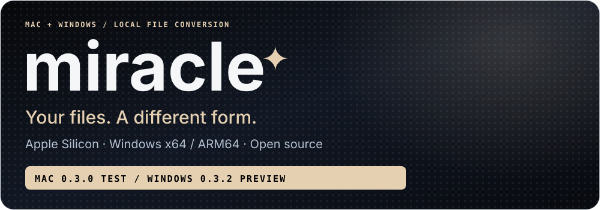
  </a>
</div>

<p align="center">
  
  
  
  
  <a href="LICENSE"></a>
</p>

<!-- 01 OVERVIEW -->
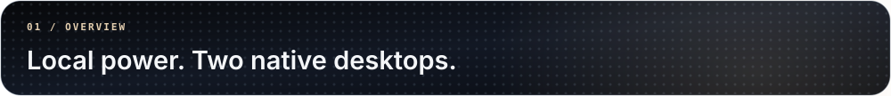
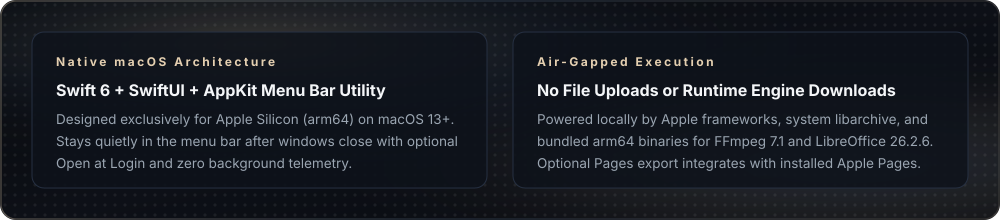

<!-- 02 WORKFLOW & USE -->
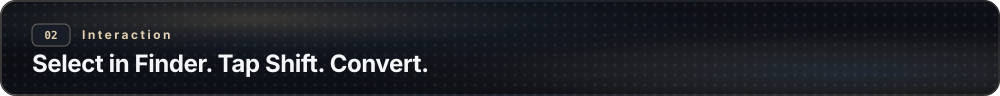
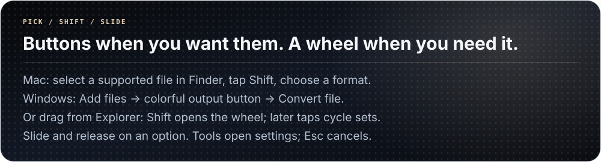

<!-- 03 COVERAGE & CAPABILITIES -->
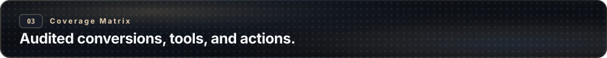
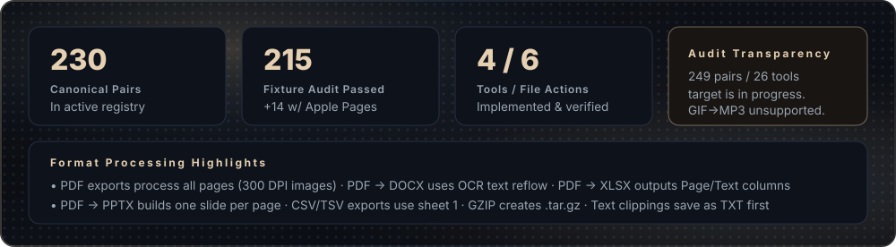

<p align="center">
  <a href="Docs/COVERAGE.md"></a>
  <a href="Docs/CONVERSION_CATALOG.csv"></a>
  <a href="Docs/TOOLS_CATALOG.csv"></a>
</p>

<!-- 04 ARCHITECTURE & ENGINES -->
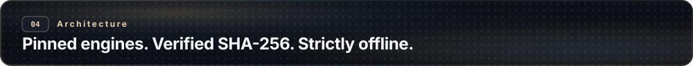
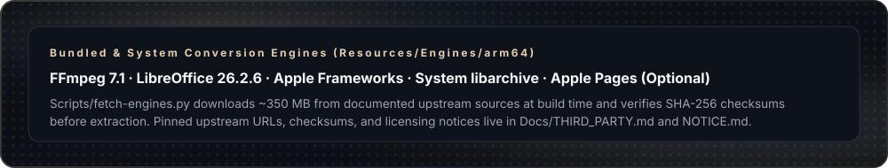

<!-- 05 BUILD & XCODE -->
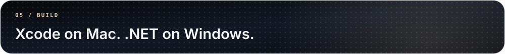

```sh
# 1. Fetch pinned external engines (~350 MB, SHA-256 verified into Resources/Engines/arm64)
python3 Scripts/fetch-engines.py

# 2. Generate Xcode project from source folders
python3 Scripts/generate_xcode_project.py
```

> **Build & Run:** Open `Miracle.xcodeproj`, choose the **Miracle** scheme and **My Mac**, then press `⌘R` (`⌘U` runs hosted tests). Engine downloads happen strictly at build time—the running app stays 100% offline. Existing local engine copies in `Resources/Engines/arm64` are preserved.

<!-- 06 INSTALLERS & CONTRIBUTING -->

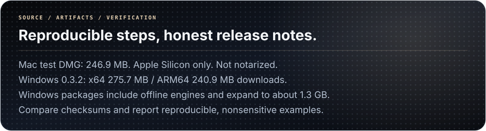

```sh
# Run standard Swift package & hosted regression tests
Scripts/test.sh

# Run opt-in complete conversion catalog matrix audit
MIRACLE_FULL_MATRIX_REPORT="$PWD/Docs/CONVERSION_RESULTS.csv" Scripts/test.sh

# Build local ad-hoc signed arm64 test installer (output/miracle.dmg, <270 MB limit)
Scripts/build-dmg.sh
```

<p align="center">
  <a href="Docs/INSTALL.txt"></a>
  <a href="Docs/THIRD_PARTY.md"></a>
  <a href="NOTICE.md"></a>
  <a href="LICENSE"></a>
</p>

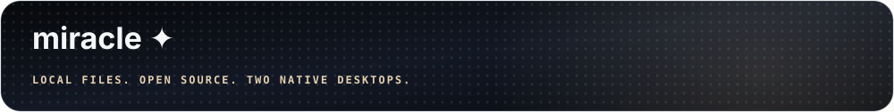
